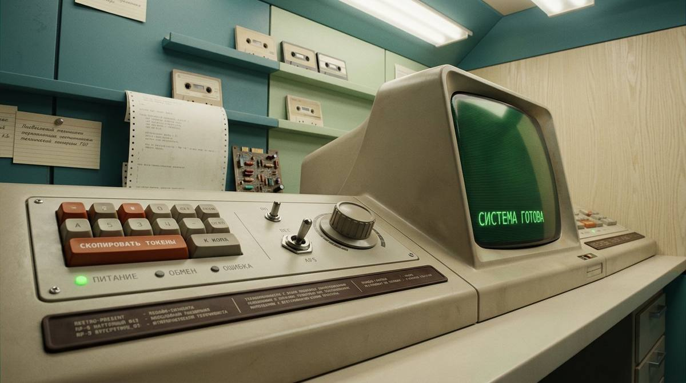
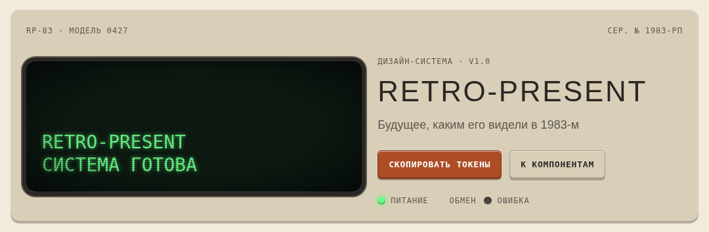
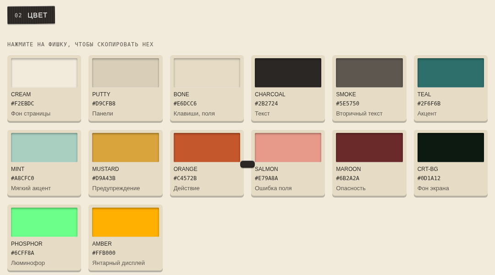
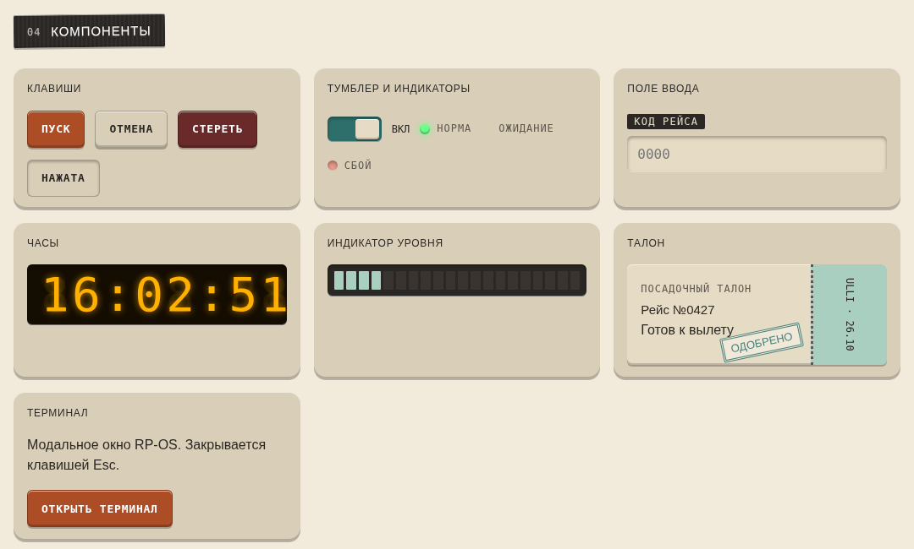
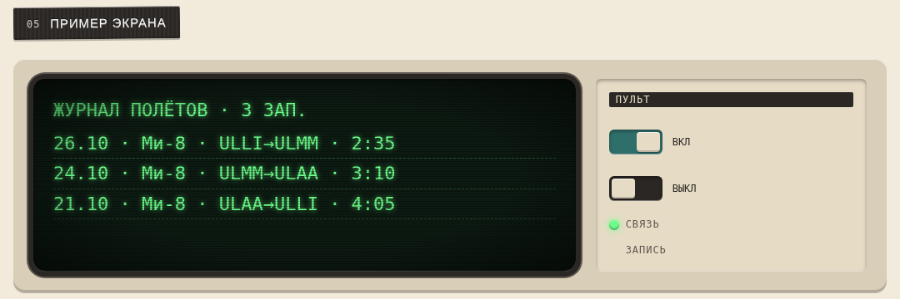

# Retro-Present — дизайн-система

Кассетный футуризм: будущее, каким его видели в 1983-м. Вдохновлено визуальным языком сериала «Маниак» (2018). Неофициально.

- `index.html` — живая витрина: принципы, цвет, типографика, компоненты, пример экрана «Журнал полётов».
- `tokens.css` — токены (`:root`): цвета, радиусы, отступы, тени-фаски.

Шрифты (Google Fonts): Michroma, IBM Plex Sans, VT323, Space Mono.

Примечание: оранжевые кнопки с белым текстом используют затемнённый `#AD4D26` ради контраста; токен `--orange` остаётся `#C4572B`.

## Как выглядит

